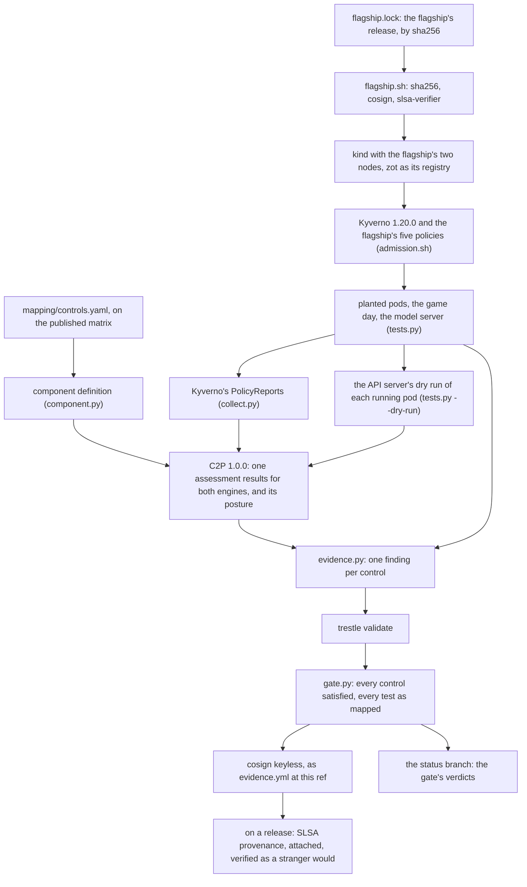

# kubernetes-oscal-evidence

[](https://github.com/heyvaldemar/kubernetes-oscal-evidence/actions/workflows/evidence.yml)
[](https://scorecard.dev/viewer/?uri=github.com/heyvaldemar/kubernetes-oscal-evidence)
[](https://github.com/heyvaldemar/kubernetes-oscal-evidence/blob/status/status.json)
[](https://github.com/heyvaldemar/kubernetes-oscal-evidence/blob/status/status.json)
[](https://github.com/heyvaldemar/kubernetes-oscal-evidence/blob/status/status.json)
[](https://github.com/heyvaldemar/kubernetes-oscal-evidence/blob/status/status.json)
[](https://github.com/heyvaldemar/kubernetes-oscal-evidence/blob/status/status.json)

The second row of badges is not typed by hand: it is the last 30 days of Evidence runs on main, which come with every push and every week, rewritten after each run by [`.github/workflows/status.yml`](.github/workflows/status.yml) into the [`status`](https://github.com/heyvaldemar/kubernetes-oscal-evidence/tree/status) branch. Its checks are the gate's own verdicts on each control, each admission test and each plant.

Out of the box, Kyverno 1.19 wrote no result for the flagship's model-signature policy, not even about the pod it admitted: a CEL policy that can deny skips its admission report ([kyverno#16841](https://github.com/kyverno/kyverno/issues/16841)). An auditor reading the reports would have seen nothing where the cluster's strongest control was working.

This repository brings the admission policies of [kubernetes-air-gapped-ai-agent](https://github.com/heyvaldemar/kubernetes-air-gapped-ai-agent) up on kind on every push, shows them the flagship's own planted pods, and turns what happened into OSCAL assessment results with [OSCAL Compass](https://github.com/oscal-compass), the CNCF sandbox project IBM contributed: C2P reads two engines, Kyverno's PolicyReports and the API server's own answers to a dry run of each running pod, into one assessment results, and compliance-trestle builds and validates the documents. The results are signed with cosign and attached to each release, so a CISO or an auditor can check them without trusting me.

## What one run shows

From the signed evidence of [run 43778370491](https://github.com/heyvaldemar/kubernetes-oscal-evidence/actions/runs/43778370491) on main, on commit 44dc967, the flagship at v1.8.0:

| | |
|---|---|
| Controls | 7 of 7 satisfied: 2 SSDF rows of the matrix, and 4 from SP 800-53 Rev. 5.2.0 and 1 from the AI RMF on the matrix's rows; SI-7, SR-11 and CM-7(5) on both engines |
| Admission tests | 19 recorded: 16 planted pods refused, each by the policy the mapping names and with the flagship's own expected words, and 3 control pods admitted |
| The game day | Kyverno's admission controller scaled to zero: its webhook configuration went with it, and the API server's own guard refused the signed model |
| Kyverno's reports | 6 PolicyReports, 9 results, every one a pass: the model server passed all four reported policies; the ordinary pod and Kyverno's four pods passed carried-images |
| The API server | 4 answers to a dry run of the running pods, every one admitted and a pass: the model server for model-volumes, carried-images and models-need-kyverno, the ordinary pod for carried-images; each of the three refused a planted pod in the same run |
| C2P | one assessment results for both engines: 7 observations with 13 subjects, each naming its check; its posture: 7 of 7 controls satisfied, every expected check reported |
| trestle | 7 documents valid: the component definition, the 3 plans, the 3 results |
| Signature | keyless, from this workflow's identity, verified in the same run |
| The probe | egress-node reported for a moment on the admitted ordinary pod: Kyverno's background scan said "fail" |

Every push runs it again. So does a weekly schedule, and so does every release, whose evidence is made by a run on the tag itself.

## How a run goes



[`tests/e2e/run.sh`](tests/e2e/run.sh) runs it from the flagship's release to the gate, in this order, with the scripts in [`scripts/`](scripts/); the signature, the status branch and the release are steps of the workflows. Nothing from the flagship is read before its archive passes all three checks, and nothing is signed that the gate has not passed: the signing step runs only after the gate exits 0.

## The controls

This is the machine-readable form of rows that already exist. The account's [control-to-test matrix](https://github.com/heyvaldemar/fleet-ops/blob/90e44597b1f3ac96d9ea3605eeaca47cdf4d8e35/docs/control-evidence.md), shown at [heyvaldemar.com/evidence](https://heyvaldemar.com/evidence/#frameworks-h), maps SLSA, the SSDF, the OWASP Top 10 for LLM Applications and Article 12 of the EU AI Act onto checks, by hand. Every control here names the matrix row it rests on, and [`scripts/component.py`](scripts/component.py) refuses a row the pinned matrix does not have. The SSDF controls are matrix rows themselves. An SP 800-53 or AI RMF control is here only where it maps onto a row the matrix already has; the OWASP rows have no OSCAL catalog to point at, so they are named on the controls that map onto them.

Seven controls, each carried by a policy the flagship ships and proven by planted pods: pods the policy must refuse, and a control pod it must admit. They are the flagship's e2e check 9, which the matrix's LLM03 row counts as 12 planted pods refused and 2 controls admitted, and its game day step. [`mapping/controls.yaml`](mapping/controls.yaml) has every line in full, with what each control leaves out.

| Framework | Control | Matrix row | Carried by | Proven by |
|---|---|---|---|---|
| SSDF v1.1 | PS.3.2 | PS.3.2, LLM04:2025 | verify-models | model-nobom refused; model-signed admitted |
| SSDF v1.1 | PW.4.4 | PW.4.4, LLM03:2025 | verify-models | model-unlicensed, model-licence-mixed, -second, -expression refused; model-licence-concluded admitted |
| SP 800-53 Rev. 5.2.0 | SI-7 Software, Firmware, and Information Integrity | LLM03:2025, LLM04:2025 | model-volumes, verify-models | volume-elsewhere, model-unsigned, model-stranger refused; model-signed admitted |
| SP 800-53 Rev. 5.2.0 | SR-4 Provenance | PS.3.2, LLM04:2025 | verify-models | model-nobom refused; model-signed admitted |
| SP 800-53 Rev. 5.2.0 | SR-11 Component Authenticity | LLM03:2025 | carried-images, verify-models, models-need-kyverno | image-not-carried, volume-not-carried, model-unsigned, model-stranger refused; with Kyverno at zero replicas, the signed model refused; model-signed admitted |
| SP 800-53 Rev. 5.2.0 | CM-7(5) Authorized Software, allow-by-exception | LLM03:2025 | carried-images | image-by-tag, image-not-carried refused; model-signed admitted |
| AI RMF 1.0 | MANAGE 3.1 | LLM03:2025 | verify-models | model-unsigned, model-nobom, model-unlicensed refused; model-signed admitted |

**Not mapped.** SSDF PS.2.1 and PS.3.1 ask a producer to make release integrity checkable and to archive each release; no admission policy does that, and the matrix shows them through release signing. Version 1.0.0 also mapped SC-24 Fail in Known State and AC-6 Least Privilege; no matrix row carries either, so 1.1.0 does not. Their tests still run and the gate still needs them to pass: the game day now proves SR-11, and the egress-node pods prove no control. CM-14 Signed Components was mapped until 1.1.0 and is not since 1.2.0: it asks for a signature verified "using a certificate that is recognized and approved by the organization", and the flagship verifies its model against a raw public key. The flagship's own [compliance page](https://github.com/heyvaldemar/kubernetes-air-gapped-ai-agent/blob/main/docs/compliance.md) says so too and lets SR-11 carry that evidence, and so does this mapping. The matrix's gaps stay gaps; nothing here closes one.

The policies and the planted pods are read from the flagship's v1.10.0 release archive after cosign and slsa-verifier verify it ([`flagship.lock`](flagship.lock)), and Kyverno is the version that release pins, 1.20.0 with chart 3.10.0. The catalogs are NIST's own OSCAL, and they and the matrix are pinned by commit and sha256 ([`catalogs.lock`](catalogs.lock)). Every finding names the catalog's own statement id and the matrix rows it rests on.

## What Kyverno's reports needed

Installed as it ships, the flagship refuses well and reports nothing. Three settings make Kyverno report on these policies. Each changes what Kyverno writes down, and nothing the API server decides:

1. **A native policy is reported only when it carries the label `reports.kyverno.io/enabled=true`.** Four of the five policies are Kubernetes ValidatingAdmissionPolicies, and the flagship's carry no label. [`scripts/admission.sh`](scripts/admission.sh) adds it to three.
2. **A CEL policy whose actions include Deny gets no admission report, even for a pod it admits.** In Kyverno 1.19.2, the handlers for ImageValidatingPolicy and ValidatingPolicy decide "blocked" from the policy's actions, not from the outcome (`pkg/webhooks/resource/ivpol/handler.go`, `audit()`), and skip the report when it is set ([kyverno#16841](https://github.com/kyverno/kyverno/issues/16841)). The legacy ClusterPolicy path decides from the outcome. The flagship's verify-models also turns Kyverno's background scan off, so no path reports it at all. Here its background scan is on: Kyverno re-verifies each running pod's model and writes the result. That field, and the operator's public key that the flagship's own install writes in the same way, are the only differences from the flagship's file.
3. **Kyverno's reports controller cannot read a webhook configuration**, which is the parameter of models-need-kyverno. Without a role that lets it, Kyverno logs "forbidden" and gives up on the report of each pod that policy matches; until the role was added, verify-models never reached the model server's report either. One aggregated ClusterRole grants read.

All three are still needed on Kyverno 1.20.0, which the flagship runs since v1.10.0. [Run 43039211836](https://github.com/heyvaldemar/kubernetes-oscal-evidence/actions/runs/43039211836) left each out in turn on 1.20.0-rc.5, the commit 1.20.0 was released from, and found each still needed.

The fifth policy cannot be reported honestly. Kyverno's background scan evaluates every stored object as if it were being created (`pkg/admissionpolicy/validate.go`, `admission.Create`). egress-node refuses a pod that names its node at creation, and every pod the scheduler placed names its node. So the report says "fail" for pods that broke nothing. Every run measures this again: after the reports are collected, egress-node is reported for a moment on the admitted ordinary pod, and the answer is kept as `reporting-probe.json`. So egress-node is judged by its admission tests alone, and since 1.1.0 no control rests on it.

## What C2P needed

C2P 1.0.0, the Python implementation, of 2026-11-10 ([docs/decisions/0005](docs/decisions/0005-c2p-1-0-beside-its-own-trestle.md)). It reads several engines and aggregates them into one assessment results, and every observation names its check as well as its rule, so the engine behind it. Four things about it, each measured:

1. **It needs compliance-trestle 3.x.** It declares `compliance-trestle~=3.3`. With the 5.2.1 the evidence is written with, it does not import: "no validator found for <class 'trestle.oscal.common.Finding'>". With 4.0.0, 21 of its 31 framework tests fail. So it runs in an environment of its own, `.cache/c2p`, with trestle 3.12.4 and every file by hash ([`c2p/requirements.lock`](c2p/requirements.lock)); the two trestles meet only in JSON files.
2. **Two of its dependencies are imported nowhere.** `jq==1.6.0` does not build on Python 3.13 ([compliance-to-policy#38](https://github.com/oscal-compass/compliance-to-policy/issues/38)); neither it nor `PyGithub==1.58.0` is imported by C2P or by the plugins run here, and [`c2p/overrides.txt`](c2p/overrides.txt) leaves both out.
3. **Its plugins are not in its wheel.** The five files the run imports come from the commit its signed v1.0.0 tag names, each by sha256 ([`c2p/plugins.lock`](c2p/plugins.lock)).
4. **Its posture calls a control satisfied when an engine says nothing.** C2P writes no findings; its control-level verdict is its posture, and a check that reported nothing shows only in the control's coverage, "1 of 2 expected check(s) reported", beside the state `satisfied`. Here that control is not satisfied, and a plant shows the gate catching it.

Kyverno's reports reach it unchanged: its kyverno-cel plugin takes each result's resource from the report's `scope` and gives a passing result with no message its own "no message". The two changes [`scripts/collect.py`](scripts/collect.py) made for C2P v2.0.0-rc.1, the Go implementation, until 1.2.0 are gone with it, and so is the plugin manifest that release got wrong ([compliance-to-policy-go#322](https://github.com/oscal-compass/compliance-to-policy-go/issues/322)). The findings are written by [`scripts/evidence.py`](scripts/evidence.py), one per control, with the catalog's own statement id, and so is an assessment plan per framework. C2P's own results for both engines and its posture stay in the evidence, under `c2p/`.

## The second engine: the API server

A ValidatingAdmissionPolicy has no report API: the API server enforces it and keeps no record. What PolicyReports say about the flagship's four native policies is Kyverno's own re-evaluation of them in its background scan, which treats every stored pod as if it were being created. So for the three that carry controls (model-volumes, carried-images, models-need-kyverno; `dry_run: true` in the mapping), the API server is asked as well. [`scripts/tests.py --dry-run`](scripts/tests.py) sends each running pod again, as a new pod under another name, with a server-side dry run: the policies answer in the API server, and nothing is stored. C2P's vap plugin turns each answer into an observation beside Kyverno's.

An admission is the absence of a complaint, and a policy that is not there does not complain either. So an admitted dry run is a pass for a policy only when the same run saw that policy refuse a planted pod; otherwise it is `error`, never a pass. A refusal by the policy is a failure, and a refusal by another policy first leaves this one's verdict unknown.

## How a control is judged

A control is satisfied in a run only when all three hold:

1. C2P's posture calls it satisfied.
2. Every check the component definition declares for every policy that carries it reported at least one running pod, and every result is a pass: Kyverno's report, and for a native policy marked `dry_run`, the API server's answer too.
3. Every test that proves it did what the mapping says: refused by the named policy, with the flagship's own expected words, or admitted.

A control C2P does not call satisfied is never called satisfied here, and a control C2P calls satisfied while one of its engines said nothing is not satisfied here; a test holds each. [`scripts/gate.py`](scripts/gate.py) reads the signed assessment results themselves, parsed by trestle's models, and exits 1 on any control short of satisfied or any failed admission test, 2 when a document is missing or unreadable. No evidence is a failure, never a pass. Given a plant, the gate passes only if every control resting on the planted policy is not satisfied and a pod that policy must refuse got in: caught for the planted reason, not for some other. A plant that silences an engine breaks no policy, so it is caught only if every control resting on what that engine judges is not satisfied, each because the engine reported nothing.

## The plants

A gate that has never failed proves nothing. Every push runs the whole thing eight more times, broken on purpose, and each of those jobs passes only if the gate fails, and fails on every control that rests on what was broken:

| Plant | What it breaks | Not satisfied | Tests failed |
|---|---|---|---|
| `remove:verify-models` | The signature policy is never applied | all 7: the guard then refuses every model, the signed control pod with them | 9 or 11 of 19 |
| `audit:verify-models` | The signature policy records instead of refusing, and a model nobody signed runs | PS.3.2, PW.4.4, SI-7, SR-4, SR-11, MANAGE 3.1 | 7 |
| `phantom-mapping` | The mapping names `verify-model-signatures`, a policy the flagship does not have | PS.3.2, PW.4.4, SI-7, SR-4, SR-11, MANAGE 3.1 | 7 |
| `remove:carried-images` | No list of carried digests | SR-11, CM-7(5) | 3 |
| `remove:model-volumes` | No native check on where model weights come from | SI-7 | 1 |
| `remove:models-need-kyverno` | No guard while Kyverno is away | SR-11 | 1 |
| `remove:egress-node` | Nothing keeps pods off the egress node | none rests on it | 3 |
| `silent:api-server` | The second engine says nothing: the dry run records no answer | SI-7, SR-11, CM-7(5), each because the API server reported no running pod | 0 |

Each was caught in [run 41361749143](https://github.com/heyvaldemar/kubernetes-oscal-evidence/actions/runs/41361749143), with 1.2.0's mapping in [run 43101983853](https://github.com/heyvaldemar/kubernetes-oscal-evidence/actions/runs/43101983853), and with the second engine and its plant in [run 43775335140](https://github.com/heyvaldemar/kubernetes-oscal-evidence/actions/runs/43775335140), each for its own reason: a plant passes only if a pod the broken policy must refuse got in. The controls each plant breaks are the same in every run. One count is not: with verify-models gone, `model-by-tag` and `volume-elsewhere` are refused by the guard and by a second native policy at once, and the API server names only one of them, not always the same one. When it names the guard, those two tests fail as well: 9 failed tests in runs [41361749143](https://github.com/heyvaldemar/kubernetes-oscal-evidence/actions/runs/41361749143), [41362793471](https://github.com/heyvaldemar/kubernetes-oscal-evidence/actions/runs/41362793471) and [41364822342](https://github.com/heyvaldemar/kubernetes-oscal-evidence/actions/runs/41364822342), 11 in [41358080026](https://github.com/heyvaldemar/kubernetes-oscal-evidence/actions/runs/41358080026) and the tag's [41363728342](https://github.com/heyvaldemar/kubernetes-oscal-evidence/actions/runs/41363728342). Four of them say more than that the gate works:

- **`audit:verify-models` is the PolicyReport path.** With the policy recording rather than refusing, the unsigned model ran, Kyverno's report said "fail" for its pod, and C2P turned that into its own not-satisfied finding. The other plants reach the gate through missing reports and failed tests; this one through a report that names a violation.
- **`phantom-mapping` is refused twice.** The mapping check stops it before anything runs. Built anyway, the run refuses it on its own: Kyverno reports `verify-models`, nothing reports `verify-model-signatures`, and every test is refused by a policy the mapping does not name.
- **`silent:api-server` is caught where C2P's posture is not.** With the dry run recording nothing, the gate found SI-7, SR-11 and CM-7(5) not satisfied, each because the API server reported no running pod. C2P's own posture, on the same files with the dry run empty, calls all three satisfied, with 2 of 3, 3 of 5 and 1 of 2 of their expected checks reported, and a test holds that it still does. The removal plants show the other half: with carried-images, model-volumes or models-need-kyverno gone, the dry run of the running pods was still admitted, and since that policy refused no planted pod in the run, the API server's answer for it was `error`, never a pass.
- **`remove:model-volumes` admitted the model from elsewhere.** The flagship's verify-models carries the same rule, "model weights come only from registry.boundary.internal:5000/models", and both policies print it. But Kyverno evaluates verify-models only for images that match its own `matchImageReferences` glob, so an image volume from anywhere else never reaches it. model-volumes is the only rule that holds the path, not a second layer.

The gate's own rules are shown their failures too. [`tests/test_evidence.py`](tests/test_evidence.py) runs them on one real run's files, breaking one thing at a time, and [`scripts/mutate.py`](scripts/mutate.py) switches each rule off in a copy of the scripts, from [`tests/plants.tsv`](tests/plants.tsv), and requires a named test to fail. The first time it ran, 4 of 20 changes went unnoticed: one test passed because the changed gate crashed rather than because it judged, one change sat on a branch its test never reached, one rule is backed by the next so that switching it off alone changes nothing, and one test broke the mapping in more ways than the rule it was written for. The tests and the changes were fixed until each change is caught by its own test; 30 are listed now.

The static checks are held to the same rule. [`scripts/validate.sh`](scripts/validate.sh) runs seven of them without a cluster: the mapping against the flagship's release and NIST's catalogs, the cluster's nodes and the model server against the flagship's, every container image by digest, trestle on the committed documents, the gate's tests, and the changes above. [`tests/static/plants.tsv`](tests/static/plants.tsv) breaks them in copies of the repository, 11 ways, and [`tests/static/plant_violations.py`](tests/static/plant_violations.py) requires the named check to fail on each.

## What the evidence proves, and what it does not

It proves that in one CI run, on a kind cluster built from the flagship's own node image, the flagship's admission policies at a verified release refused every planted pod they exist to refuse, for the reason they exist to refuse it, admitted the control pods, and that Kyverno's reports of the running pods and the API server's own answers on a dry run of them agreed. It proves that the documents saying so were made by this repository's workflow at a named commit, and have not changed since.

It does not prove:

- **That any system meets a framework.** A control's statement asks for more than a policy does. Each mapping line says what is left out, and an organisation's procedures, people and reviews are never in a PolicyReport.
- **That the flagship's production install is configured this way.** The cluster here is kind, with the network open: the flagship's boundary, its bundle and its registry account are not reproduced. carried-images is given the digests these pods use, where the flagship gives it what its signed bundle carried.
- **Anything about the weights.** The model is a small signed stand-in; admission reads signatures and AI-BOMs, never the file.
- **Anything between runs.** A run is a sample. The schedule runs it weekly, and each run's evidence stands alone.

## Check it yourself

Each release carries the run's evidence beside its source: `kubernetes-oscal-evidence-<tag>-evidence.tar.gz`, its Sigstore bundle, and its SLSA provenance. The evidence was made by a run of the Evidence workflow on the tag itself, and nothing in this repository needs to be trusted to check it.

```sh
TAG=$(gh release view -R heyvaldemar/kubernetes-oscal-evidence --json tagName -q .tagName)
NAME=kubernetes-oscal-evidence-$TAG-evidence
gh release download "$TAG" -R heyvaldemar/kubernetes-oscal-evidence -p "$NAME.*"
```

**The signature, offline.** cosign needs Sigstore's trust root and the bundle, nothing else. On any connected machine `cosign initialize` writes the trust root to `~/.sigstore/root/tuf-repo-cdn.sigstore.dev/targets/trusted_root.json`; carry that file across with the evidence.

```sh
cosign verify-blob "$NAME.tar.gz" --bundle "$NAME.tar.gz.sigstore.json" --trusted-root trusted_root.json \
  --certificate-identity "https://github.com/heyvaldemar/kubernetes-oscal-evidence/.github/workflows/evidence.yml@refs/tags/$TAG" \
  --certificate-oidc-issuer https://token.actions.githubusercontent.com
```

The identity is exact: the workflow file and the tag. A signature from any other workflow, branch or repository fails.

**The provenance.** slsa-verifier checks that the archive was built by GitHub's runner from this repository at the tag; it reads Sigstore's public log, so it needs the network.

```sh
slsa-verifier verify-artifact "$NAME.tar.gz" --provenance-path "$NAME.intoto.jsonl" \
  --source-uri github.com/heyvaldemar/kubernetes-oscal-evidence --source-tag "$TAG"
```

**The documents.** Unpack it and read `evidence/summary.md` first. The OSCAL documents are `evidence/assessment-results-*.json`, each with the assessment plan it imports and the component definition beside it, C2P's own results for both engines and its posture under `evidence/c2p/`, Kyverno's reports as the cluster held them under `evidence/policyreports/`, and the API server's answers in `evidence/dry-run.json`. Validate them with compliance-trestle, and run the gate on them from the release's source archive (`kubernetes-oscal-evidence-<tag>.tar.gz`, signed and verifiable the same way, with `release-assets.yml` in place of `evidence.yml`):

```sh
tar -xzf "$NAME.tar.gz"
python3 -m venv .venv && .venv/bin/pip install --require-hashes --no-deps -r requirements.lock
PATH="$PWD/.venv/bin:$PATH" bash scripts/validate.sh evidence
PATH="$PWD/.venv/bin:$PATH" python3 scripts/gate.py evidence
```

The release workflow ran the same two checks on the files the release now holds, and showed each a copy of the archive with one byte appended, which both refused.

## Quickstart

The whole run, on kind, judged by the gate:

```sh
python3 -m venv .venv && .venv/bin/pip install --require-hashes --no-deps -r requirements.lock
export PATH="$PWD/.venv/bin:$PATH"
bash tests/e2e/run.sh
```

It needs Docker, curl, jq, openssl and Python 3.13 or later, which both locks are resolved for; everything else is downloaded and checked by hash, C2P into an environment of its own. The evidence lands in `.cache/run/evidence`, with `summary.md` to read first. `PLANT=remove:verify-models` (or any plant above) breaks it on purpose, and the gate must catch it. `REGISTRY_PORT=5055` if port 5000 is taken, as macOS takes it for AirPlay.

The static checks need no cluster, only the flagship's release and NIST's catalogs:

```sh
export PATH="$(bash scripts/install-tools.sh):$PATH"
bash scripts/flagship.sh && bash scripts/catalogs.sh
bash scripts/validate.sh
python3 tests/static/plant_violations.py
```

### Teardown

A run deletes its kind cluster and its registry container once the evidence is written and validated, before the gate judges it. A run that stops before that, or one started with `KEEP=1` to look around with kubectl, leaves both up until:

```sh
bash scripts/cluster.sh down
```

What a run downloads stays in `.cache/` (the tools, C2P's environment, the flagship's release, the catalogs, the last run's state) and `.venv/`; deleting the two removes the rest.

## What it costs

Runner time, and nothing else. Every job runs on GitHub's hosted `ubuntu-latest` runners, with no cloud account and no stored secret: the signature's identity comes from GitHub's OIDC token, and the cluster is kind on the runner. Run [41573868103](https://github.com/heyvaldemar/kubernetes-oscal-evidence/actions/runs/41573868103) on main took 12 minutes, with nine jobs and about 49 runner-minutes in all, most of them the seven plants; GitHub's timing API reports 0 billable milliseconds for it, as the repository is public. It runs on every push, every week and on each release.

On a machine of your own it costs Docker's room for a two-node kind cluster and the downloads above.

## Repository

| Path | What it is |
|---|---|
| `mapping/controls.yaml` | The mapping, written for a person: each control, the policy that carries it, the tests that prove it, what it leaves out |
| `oscal/component-definition.json` | The same mapping as an OSCAL component definition, made by `scripts/component.py` with trestle's models |
| `flagship.lock`, `catalogs.lock`, `tools.lock`, `requirements.lock` | What is fetched, and the hash it must have |
| `c2p/` | C2P's own pins: its environment by hash, the override that leaves out what it never imports, its plugins by sha256 |
| `kind/cluster.yaml` | The flagship's two nodes; CI checks they are the same |
| `manifests/model-server.yaml` | The good workload: a model server shaped like the flagship's, held to it by `scripts/validate.sh` |
| `scripts/` | The run's steps; `validate.sh`, the static checks; `status.py`, which writes the `status` branch from the runs |
| `tests/e2e/run.sh` | The whole run, as CI runs it |
| `tests/` | The gate's tests on one real run's files, and `plants.tsv`, each rule of the gate switched off in turn; `static/plants.tsv`, each static check shown its violation |
| `docs/decisions/` | Why it is built this way, one record per decision |

## Questions, bugs and changes

Open an [issue](https://github.com/heyvaldemar/kubernetes-oscal-evidence/issues) for a bug, a question or an idea. Security reports go privately, as [SECURITY.md](SECURITY.md) describes.

## How this is built

One maintainer and an AI agent. The agent writes most of the code; the decisions are mine, and so is the verification. Nothing merges on the agent's report that it works: it merges on the checks above, and each of them has been shown the failure it exists to catch. The rules the agent works under are in [AGENTS.md](AGENTS.md).

## License

[MIT](LICENSE).
